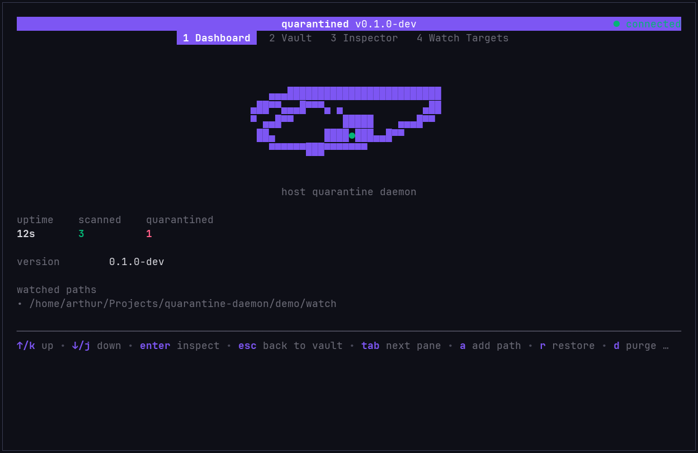

# quarantined

User-space host quarantine and static file triage daemon.



`quarantined` watches the directories where risky files land (`~/Downloads`, `/tmp`, AUR helper
caches), statically analyses new executables and `PKGBUILD` build scripts **without ever
executing them**, scores them, and atomically isolates high-confidence threats in a quarantine
vault. A Bubble Tea TUI provides live telemetry, vault browsing, file inspection and safe
restore.

Written in Go. No root, no kernel module, no LD_PRELOAD.

## Demo


## Status

Phase 6 complete (validation corpus + end-to-end suite). Version `0.1.0-dev`, pre-release.

## Threat model

This is a **reactive, user-space** daemon. It observes filesystem events and acts after a file
appears. It cannot block a `write`/`exec` pair synchronously the way an in-kernel EDR can, and it
does not see processes that never touch a watched directory. It is a staging-area containment
layer, not a complete endpoint agent. Kernel-level synchronous pre-execution blocking is a
separate design (`PLAN_KERNEL_EDR.md`, not in this repository).

## How it works

```text
fsnotify watcher (recursive, debounced)
        |
        v
Ingestion pipeline  ->  Static triage  ->  Multi-factor score
                             |                     |
                    ELF / PE / Mach-O        < 50  PASS (log only)
                    Shannon entropy          50-84 ALERT (TUI)
                    PKGBUILD full AST        >= 85 QUARANTINE
        |
        v
Quarantine vault  ->  IPC server (Unix socket, SO_PEERCRED)  ->  TUI client
```

- **Watcher** (`internal/watcher`) — recursive `fsnotify`; new subdirectories get their own watch
  before files are written. `IN_MOVED_TO` and `PKGBUILD` creation trigger immediately, binary
  payloads are debounced 300ms on `IN_CLOSE_WRITE`. Queue overflow triggers a full directory walk
  reconciliation.
- **Safe file access** (`internal/fsutil`) — `OpenSafe` uses `O_NOFOLLOW|O_CLOEXEC`; reads are
  bounded (`ReadBounded`, 64MB cap) so a hostile file cannot exhaust memory.
- **Binary triage** (`internal/triage/binary`) — ELF, PE and Mach-O parsers. Signals: writable and
  executable `PT_LOAD` segment (+40), executable `GNU_STACK` (+35), high section entropy,
  packer/encryption heuristics (+25), IOC strings such as `VirtualAllocEx` (+20), word-bounded
  non-private IPs (+35).
- **PKGBUILD triage** (`internal/triage/pkgbuild`) — full AST parse via `mvdan.cc/sh/v3/syntax`,
  covering root scope, subshells, every function (`pkgver`, `prepare`, `build`, `check`,
  `package`) and `*.install` scriptlets. Detects remote execution (`curl ... | sh`, `eval`,
  `base64 -d`, `/dev/tcp`), writes outside packaging staging variables (`/etc/sudoers`, `~/.ssh`,
  `~/.bashrc`) and untrusted `source=()` hosts. VCS packages are exempt from `SKIP`-checksum
  penalties; legitimate forge and mirror hosts are allowlisted.
- **Quarantine vault** (`internal/quarantine`) — atomic cross-mount move into
  `~/.local/share/quarantined/vault/`, original artifact locked with `fchmod 0000` (POSIX) or a
  deny-all DACL (Windows), plus a `<sha256>.meta.json` sidecar recording SHA-256, original path,
  original mode, uid/gid and triggering signals. `PKGBUILD` artifacts are additionally replaced
  in place by a stub that exits non-zero, so `makepkg` cannot proceed.
- **IPC** (`internal/ipc`) — newline-delimited JSON RPC over
  `$XDG_RUNTIME_DIR/quarantined.sock`, mode `0600`, peer authenticated with `SO_PEERCRED` so only
  the owning UID can connect. Methods: `Ping`, `GetStatus`, `ListVault`, `InspectItem`,
  `RestoreItem`, `PurgeItem`, `AddWatchPath`.
- **TUI** (`internal/tui`) — auto-reconnecting Bubble Tea client with four panes: Dashboard
  (live feed, counters, hunter-eye emblem), Vault, Inspector and Watch Targets.

## Requirements

- Go 1.26 or newer (see `go.mod`)
- Linux, macOS or Windows
- systemd **user** session (optional, for running it as a service)

## Install

```bash
git clone https://github.com/OnlyOneArthur/quarantine-daemon.git
cd quarantine-daemon
./install.sh
```

The installer builds the binary into `~/.local/bin/quarantined` and, unless `--no-service` is
given, installs and enables `quarantined.service` as a systemd **user** unit.

```text
./install.sh [options]

  --prefix DIR     install prefix (default: ~/.local)
  --bin-dir DIR    binary destination (default: PREFIX/bin)
  --no-service     build and install the binary only
  --no-enable      install the unit but do not enable/start it
  -h, --help       show help
```

Environment overrides: `PREFIX`, `BIN_DIR`, `DESTDIR`.

### Manual install

```bash
go build -o ~/.local/bin/quarantined ./cmd/quarantined
mkdir -p ~/.config/systemd/user
cp systemd/quarantined.service ~/.config/systemd/user/
systemctl --user daemon-reload
systemctl --user enable --now quarantined
```

### Run without installing

```bash
# daemon in the foreground
go run ./cmd/quarantined -config demo/demo.toml

# TUI in a second terminal
go run ./cmd/quarantined -tui -config demo/demo.toml
```

`demo/demo.toml` watches only `demo/watch/` and quarantines into `demo/vault/`, so it is safe to
experiment with. Relative paths in a config file resolve against that file's directory, so the demo
works from any working directory.

To see a quarantine happen, drop a fixture into the watched directory while the daemon runs:

```bash
mkdir -p demo/watch/evil-pkg
cp demo/fixtures/malicious/PKGBUILD demo/watch/evil-pkg/PKGBUILD
```

The PKGBUILD engine only runs on a file whose basename is exactly `PKGBUILD` (or ends in
`.install`), which is why each fixture sits in its own directory. Dropping it under any other name
sends it to the binary engine instead. `demo/fixtures/clean/PKGBUILD` is the benign counterpart
and passes.

## Usage

```text
quarantined [-config path/to/config.toml] [-log-level debug|info|warn|error]
quarantined -tui [-config path/to/config.toml]
quarantined -version
```

Run with no `-config` and the built-in defaults apply: watch `~/Downloads`, `/tmp`,
`~/.cache/yay` and `~/.cache/paru/clone`; quarantine at score >= 85 into
`~/.local/share/quarantined/vault`.

### TUI keys

| Key | Action |
| --- | --- |
| `1` / `2` / `3` / `4` | Dashboard / Vault / Inspector / Watch Targets |
| `tab` | next pane |
| `up`/`k`, `down`/`j` | move selection |
| `g`, `G` | top, bottom |
| `pgup`/`ctrl+u`, `pgdn`/`ctrl+d` | page up, page down |
| `enter` | inspect selected item |
| `esc` | back to vault |
| `a` | add a watch path |
| `r` | restore selected item to its original path |
| `d` | purge selected item permanently |
| `y` / `n` | confirm / cancel |
| `?` | expanded help |
| `q` / `ctrl+c` | quit |

## Configuration

TOML, passed with `-config`. Any field left out keeps its default.

```toml
[service]
log_level = "info"          # debug | info | warn | error
poll_interval_ms = 300      # debounce window for write-then-close events
socket_path = "$XDG_RUNTIME_DIR/quarantined.sock"  # falls back to ~/.local/state

[paths]
watch = ["~/Downloads", "/tmp", "~/.cache/yay", "~/.cache/paru/clone"]
ignore_extensions = [".crdownload", ".part", ".tmp"]

[triage_binary]
enabled = true
entropy_threshold = 7.3
max_scan_size_mb = 64

[triage_pkgbuild]
enabled = true
block_untrusted_sources = true
flag_skip_checksums = true

[quarantine]
vault_dir = "~/.local/share/quarantined/vault"
threshold_score = 85        # >= this score is quarantined
max_vault_size_mb = 1024
retention_days = 14
```

## Development

```bash
go vet ./...
go test -count=1 ./...
```

11 packages are covered: `cmd/quarantined`, `internal/config`, `internal/fsutil`, `internal/ipc`,
`internal/logger`, `internal/quarantine`, `internal/triage/binary`, `internal/triage/entropy`,
`internal/triage/pkgbuild`, `internal/tui`, `internal/watcher`.

`testdata/` holds the synthetic validation corpus: clean and malicious PKGBUILDs, ELF and PE
fixtures (executable stack, RWX segment, embedded reverse-shell IOCs), high/low entropy blobs and
benign scripts. `cmd/quarantined/integration_test.go` exercises the full pipeline plus every IPC
method end to end.

## Uninstall

```bash
./uninstall.sh            # stop + remove service and binary, keep the vault
./uninstall.sh --purge    # also delete the vault and config
./uninstall.sh --dry-run  # print what would be removed
```

The vault is never touched unless `--purge` is passed and confirmed. `--purge` destroys the only
copy of every quarantined file; restore what you need first with `r` in the TUI.

## License

[MIT](LICENSE)
